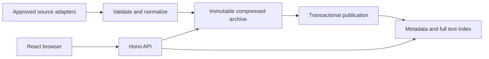

# Archive pilot implementation

This describes the archive foundation. The current search/enrichment implementation and operational commands are in [Phase 2](phase2.md).

## Implemented

- React archive, latest-publication view, research view, source/run dashboard, and full-text reader.
- Shareable URL query/filter/document state; pagination; keyboard search shortcut; responsive layout.
- Postgres source/document/revision/chunk/run/job tables with Supabase RPCs and private object storage.
- Identical search SQL in local PGlite and hosted Supabase; no client-side mock database.
- Synonyms for XSS, SQLi, SSRF, IDOR, ATO, OAuth, CSRF, RCE, XXE, SSTI, traversal and request smuggling. Related concepts are not automatically treated as exact aliases.
- OWASP licensed full text, historical public index, RSS/Atom, optional HackerOne metadata discovery.
- Immutable compressed archive files; content hashes; source licenses; retries; bounded jobs; process/job leases.
- GitHub verification and opt-in hourly ingestion workflows, plus Cloudflare Worker deployment config.

## Data flow

Local mode runs Node + PGlite + filesystem objects. Production serves static assets and a Hono API from Cloudflare Workers, with RPC and private Storage access through Supabase. Do not bundle PGlite or service-role secrets into the browser.

## Invariants

1. Archive object persistence precedes the transaction that activates a revision. Failed object writes cannot publish searchable text. Failed DB writes may leave unreferenced immutable objects, which can be audited later.
2. A successful unchanged ingestion creates no revision; an upstream commit changing unrelated files does not change a document's content identity.
3. A failed extraction/metadata-only refresh cannot erase an existing complete archive. Rights revocation is a separate withdrawal operation, not an extraction downgrade.
4. A document's original publication date is never replaced by discovery time. Unknown dates remain null.
5. All query groups must match somewhere in the document; aliases inside a group are ORed. Repeated matching chunks cannot duplicate a result.
6. Public reads require published status, including detail/archive lookup. SQL RPC access is backend-only; SQL parameters are never interpolated from search text.
7. Metadata-only documents contain no copied report body. Full-text rights evidence and attribution are required by ingestion validation.

## API

| Endpoint             | Behavior                                                                          |
| -------------------- | --------------------------------------------------------------------------------- |
| GET /api/health      | Backend mode and application version                                              |
| GET /api/stats       | Counts, dates, platforms and topic facets                                         |
| GET /api/search      | q, kind, source (platform), topic, completeness, sort, page, limit, after, before |
| GET /api/items/:uuid | Metadata, provenance and permitted archived text                                  |
| GET /api/sources     | Discovery-source coverage and last successful import                              |
| GET /api/runs        | Last 20 ingestion runs                                                            |

Search defaults to 20 items/page, at most 50; query length is limited to 300 characters. SQL has a five-second statement timeout. Invalid parameters return 400, missing documents 404, unavailable data 503. Highlight markers are rendered as React text/mark elements, never injected as HTML.

## Local recovery

Stop the dev server before backup or ingestion. `.data/database.lock` records the owning process and refuses concurrent access; stale locks are reclaimed only when the process no longer exists.

For exact same-version local recovery, close all connections and copy `.data/postgres` and `.data/archive` together to independent storage, then restore both together. For portable recovery, run `npm run restore -- --from <export-directory> --target <new-data-directory>`. The command verifies every object's checksum, applies the schema, restores exported metadata and revisions, and rebuilds current search chunks. It rejects an existing target. The 500-item pilot was restored successfully; retain an independent copy of the export.

To suppress a document, change `hs_documents.status` to `withdrawn` through an administrative database session, remove the corresponding stored objects if required, and ensure any independently deployed cache is purged. No public deletion API is exposed. Audit/restore tombstones belong to the next operational phase.

## Current boundaries and next work

- Cloudflare and Supabase are now configured for the hosted installation. GitHub scheduling still requires a repository, secrets and explicit enablement.
- The 500-item pilot is a mixed catalog: 100 licensed articles with full text, 400 historical write-up/report metadata entries. It is not 500 full-text bug bounty reports.
- The curated historical index may be stale. HackerOne public-disclosure discovery has now been verified against an authenticated live response; other dedicated platform adapters remain future work.
- This version preserves text and links, not original PDF/image binaries. Generic HTML/PDF extraction and finer extraction-quality checks remain future work.
- Local refresh is a CLI operation with exclusive database ownership; hosted hourly jobs are the continuous path.
- Persistent jobs, idempotent writes and deterministic pilot sampling allow safe reruns. The initial discovery adapters rescan their bounded candidate list; deep pagination checkpoints and conditional HTTP ETag caching are not implemented yet.
- Capacity stops and distributed rate limiting are release gates before opening the service to broad public traffic. SQL/query bounds are present, but not a global request quota.
- Semantic search, exact-text duplicate grouping, near-duplicate suggestions, related research and topic collections are implemented in Phase 2. Accounts, bookmarks, notes, saved searches, alerts and revision-diff UI remain later phases.
- Security/content fixtures are synthetic and live only under tests. The pilot contains real source records, with no generated filler.

Use the architecture's 500 MB database / 1 GB Storage envelope as a planning constraint. Measure the pilot size before expanding historical ingestion or adding vector indexes.
