# Phase 5: source expansion and preservation coverage

**Current publication policy:** [Version 0.5.1](text-capture.md) excludes metadata-only records from public browsing/search and captures source text before publication. The first-rollout figures below describe the earlier discovery catalog; they are not the current readable-entry count.

HuntSignal 0.5 expands discovery to ten sources, adds full-text OWASP WSTG chapters and searchable research abstracts, and exposes preservation counts and a Papers filter. The first rollout targets 1,000 unique documents; expansion toward 2,000 follows measured database growth and search evaluation. The operator accepted a three-to-four-hour feed cadence on 18 October 2026; the workflow now explicitly requests every four hours. GitHub can delay scheduled runs.

## Architecture and source contracts

```mermaid
flowchart LR
  Registry[Versioned source configuration] --> Adapters[Public APIs, feeds and licensed Markdown]
  Adapters --> Validation[Validate public visibility, URLs, dates and rights]
  Validation --> Jobs[Durable jobs and source checkpoints]
  Jobs --> Archive[Immutable compressed text and metadata]
  Archive --> Search[Keyword index and local embedding model]
  Search --> UI[Archive, papers, source coverage and alerts]
```



The existing Supabase tables, private Storage bucket, Cloudflare Worker and GitHub runner remain the stack. No paid API or service is added. `ingestion/sources.ts` and `ingestion/feeds.json` define source identity and polling interval. A backend-only registration RPC updates names and intervals without changing operator pauses, leases or checkpoints. Migration 012 adds that RPC and aggregate coverage fields; 013 keeps the strongest capture and prefers direct publishers over directory metadata when canonical URLs overlap. Durable table shapes and backup schema version 9 remain unchanged.

| Source                      | Discovery and preservation                                                                                                      | Interval |
| --------------------------- | ------------------------------------------------------------------------------------------------------------------------------- | -------- |
| HackerOne                   | Existing authenticated Hacktivity adapter; explicitly disclosed metadata only                                                   | 4 hours  |
| Bugcrowd                    | Public CrowdStream disclosure filter; only `disclosed=true` entries, original disclosure links, researcher visibility respected | 4 hours  |
| Pentester Land              | Existing historical index with resumable batches                                                                                | Daily    |
| OWASP Cheat Sheet Series    | Existing licensed full Markdown captures                                                                                        | Weekly   |
| OWASP WSTG                  | Web application testing chapters from a commit-pinned tree; license checked at that revision; full Markdown, no image downloads | Weekly   |
| PortSwigger Research        | Official RSS, article metadata and links                                                                                        | 4 hours  |
| Intigriti Research          | Official researchers' feed filtered to techniques and Bug Bytes; article metadata                                               | 4 hours  |
| InfoSec Write-ups (Medium)  | Publication RSS; article metadata and authors                                                                                   | 4 hours  |
| YesWeHack Research          | Public Learn Bug Bounty listing and article structured metadata                                                                 | 4 hours  |
| arXiv web security research | Topic-filtered API; abstracts and descriptive metadata preserved under CC0, explicitly marked partial                           | Daily    |

Intigriti and YesWeHack coverage in this release is **research articles**, not direct platform submission disclosures. Their dedicated report APIs remain unimplemented. HackerOne's [Hacker API](https://api.hackerone.com/hacker-resources/) only includes vulnerability information when the requesting hacker owns the report; this archive does not import private account submissions. Bugcrowd's public JSON shape was verified against its own CrowdStream interface; because it is not a versioned API, schema drift fails visibly rather than creating placeholder reports.

The [WSTG license](https://github.com/OWASP/wstg/blob/master/LICENSE) permits CC BY-SA 4.0 capture with attribution and license evidence. [arXiv's API terms](https://info.arxiv.org/help/api/tou.html) explicitly cover abstracts in CC0 descriptive metadata and require separate permission for redistributing full papers. This release stores abstracts, not PDFs. An RSS publication does not by itself grant full-article archival permission, so the new blog feeds retain metadata and original links. The UI distinguishes full text, partial text and metadata throughout.

## Checkpoints, limits and quality

- WSTG holds one commit for a batch, resumes at its next file, and stops fetching bodies once that revision is complete. Short upstream removal/placeholder files below the archive's 80-character minimum are excluded. Publication dates remain unknown instead of being replaced by commit dates.
- Bugcrowd scans at most five pages per run; recent checks always start at the head and backfill retains page/offset separately. Accepted but undisclosed submissions never enter the archive. Date-only disclosure values are normalized to UTC consistently on Windows and Linux.
- arXiv makes one request per invocation, at most 50 papers, with a three-second minimum wait. Historical queries use a separate offset; repeated paper versions share one canonical identity. Abstracts are searchable, and the full paper link is retained.
- YesWeHack follows only article URLs from the public category listing, at most 25 per run. It requires article structured metadata, retains publication dates and authors, and never follows arbitrary links in bodies.
- RSS/Atom validates configuration and feed shape, preserves author/category metadata, rejects entities and unapproved hosts, and resumes partial feed batches. Intigriti marketing categories are excluded by path.
- Known HackerOne URL aliases and Medium tracking parameters normalize to stable identities. Existing canonical uniqueness, identical-body grouping and citation relationships remain; different write-ups about the same vulnerability are not destructively merged.

Capacity guards and private-data boundaries from Phase 4 apply unchanged. No data is removed to make room. Search uses the existing model, with keyword publication independent of vector indexing.

## Rollout and operation

Apply `012_source_coverage.sql` and `013_source_precedence.sql` after 011, then validate and import bounded source batches:

```powershell
npx tsx scripts/check-sources.ts
npm run ingest -- refresh --remote --source bugcrowd --limit 25
npm run ingest -- backfill --remote --source owasp-wstg --limit 150
npm run ingest -- refresh --remote --source arxiv-security --limit 25
npm run enrich -- --remote --limit 500
npm run ops -- status --remote
npm run search:eval -- --remote
npm run search:eval -- --remote --cases tests/search-eval/phase5.json
npm run smoke:phase5
```

`refresh` honors source due times; add `--force` for an intentional immediate refresh. `hourly` remains a compatible CLI alias. Backfill remains explicit and independently checkpointed. The GitHub dispatch accepts a source ID as well as mode/limit. The scheduled runner uses the configured sources, bounded discovery, indexing, alerts and housekeeping. Weekly OWASP refresh remains separate.

The Phase 4 failed run on 17 October was traced to a Pentester Land job timeout. Subsequent scheduled runs recovered it, leaving zero failed or pending jobs. There is no evidence of lost records from that run.

## Verification and rollback

Source preflight samples three real entries per new adapter without writing archive bodies; results are saved in ignored `.data/source-validation.json`. Automated tests cover nonpublic rejection, hostile URLs/XML, author privacy, UTC dates, abstract licensing, WSTG text fidelity, checkpoint resume, canonical deduplication, source-registration permissions and searchable abstract coverage. The existing restore, authorization and search regression suites remain required.

After import, evaluate the existing 50-query baseline and an additional source-diverse set. Keep raw results in `.data/evaluation/`; report latency and designated-document recall without presenting that set as exhaustive relevance judgments. Verify the public paper filter, full-text reader, source links and coverage counters, then take an encrypted incremental backup.

Rollback the Worker to the preceding Phase 4 version if reader/search regressions appear. Pause affected sources in Operations before rolling back their adapter. Keep migrations 012/013, archives, suppression records and private user data. Source expansion can be paused independently of the public app.

## First rollout: 18 October 2026

The first milestone contains 1,021 canonical documents: 248 full-text guides, 25 paper abstracts and 748 metadata entries across ten configured sources (nine platform groups). All 1,021 documents were semantically indexed, with no indexing failures. Postgres used approximately 53.3 MB against the existing 500 MB budget. The next historical-growth milestone is 2,000 documents, retaining the same capacity gates and measured batch process.

The 92-test suite, type checking, production build and hosted Phase 4/5 smoke checks passed. Seven new adapters each passed a three-record live preflight. The 50-query baseline retrieved its designated article in the hybrid top 20 for 48/50 queries, with retrieval p95 497 ms (keyword p95 488 ms). The additional eleven source-diverse cases all returned their designated item at rank one, with hybrid retrieval p95 414 ms. These are designated-document regression measurements, exclude browser model startup, and do not imply perfect relevance on arbitrary queries.

The deployed Worker version is `d47e1d2d-d47d-4cc7-8ca7-26bdd8c799ce`. Browser checks verified the Papers filter, abstract reader, original-source links and license scope, with no captured console errors or horizontal overflow at the current 387-pixel viewport. WSTG's removed placeholder and Bugcrowd's underscore-containing disclosure slug were handled with regression checks; their successful resume/import results and the previously recovered directory timeout were recorded in the administrator audit trail.
